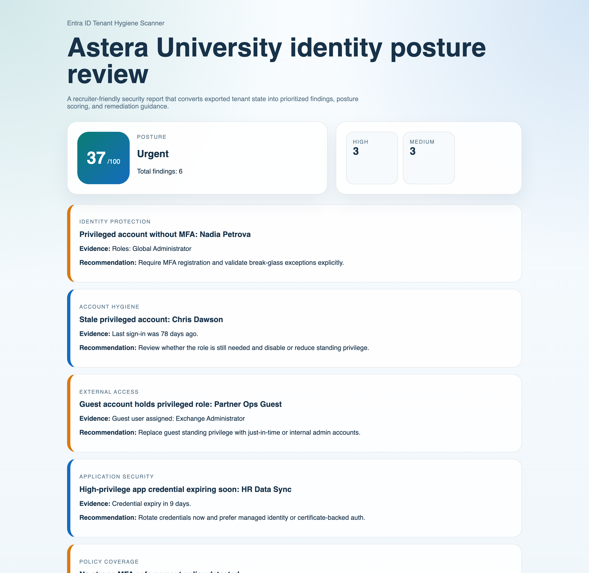

# Entra ID Tenant Hygiene Scanner

A security-focused portfolio project for scanning exported Microsoft Entra tenant state and turning it into a practical remediation report.

<p>
  
  
  
</p>

## Preview



## Why This Project

This project is aimed at showing:

- identity security thinking
- policy hygiene awareness
- risk prioritization instead of checklist dumping
- clear reporting for technical and stakeholder audiences

## Current Starter Scope

- Python standard library CLI
- sample tenant export snapshot
- deterministic rules for common tenant hygiene gaps
- markdown, JSON, and HTML reporting modes
- unit tests for key rules

## Run Locally

```bash
cd path/to/entra-id-tenant-hygiene-scanner
python3 -m scanner.cli sample_data/tenant_snapshot.json
```

JSON output:

```bash
python3 -m scanner.cli sample_data/tenant_snapshot.json --format json
```

HTML report:

```bash
python3 -m scanner.cli sample_data/tenant_snapshot.json --format html --output docs/sample-report.html
```

## Included Rules

- privileged users without MFA
- stale privileged accounts
- guest accounts with privileged roles
- expiring high-permission app credentials
- weak MFA policy coverage
- legacy authentication not clearly blocked

## Next Milestones

1. Add CSV export
2. Support live Microsoft Graph ingestion
3. Add policy scoring by control area
4. Add remediation playbooks linked to each finding

## License

Released under the MIT License. See `LICENSE`.
